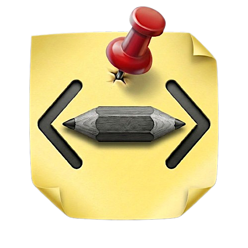
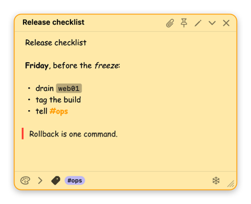
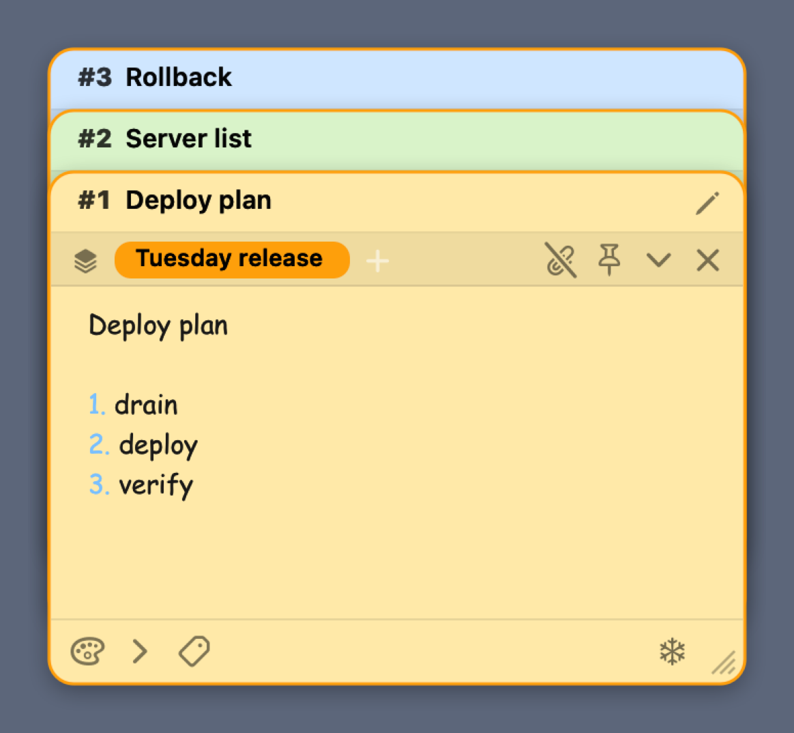
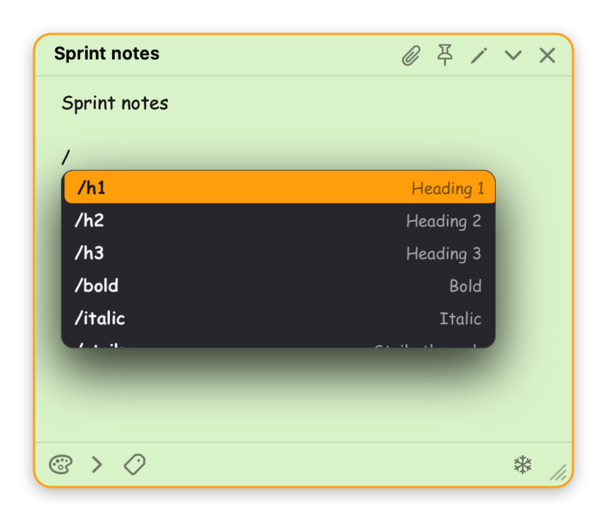
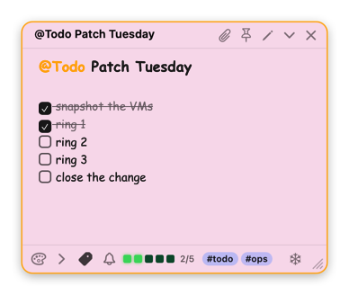
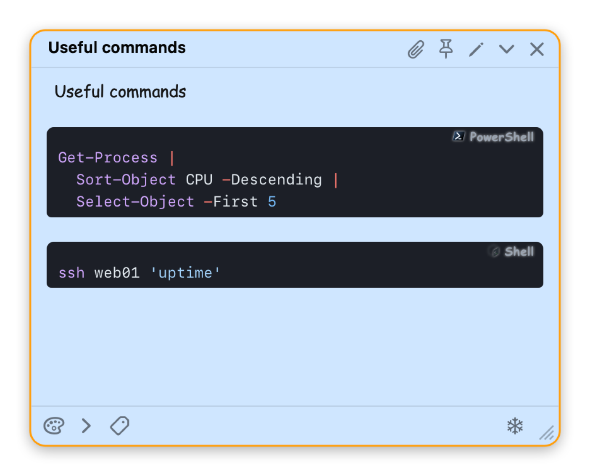
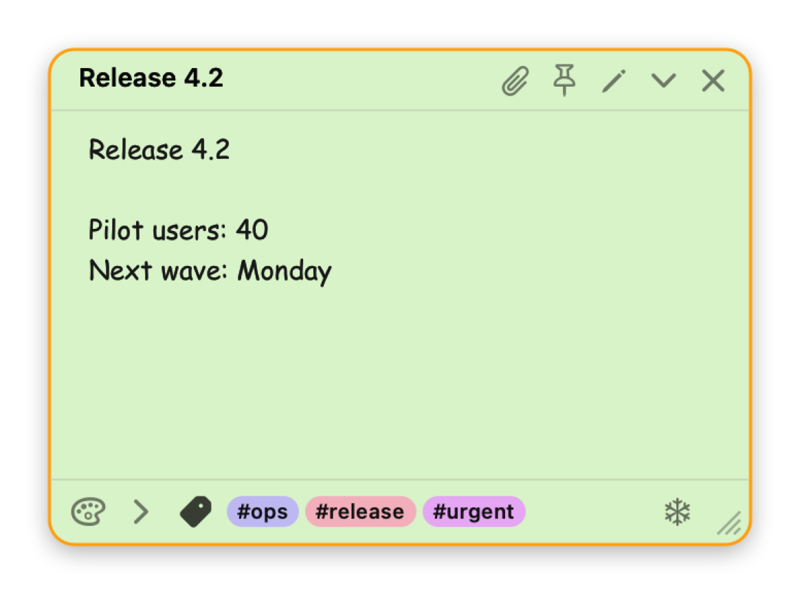
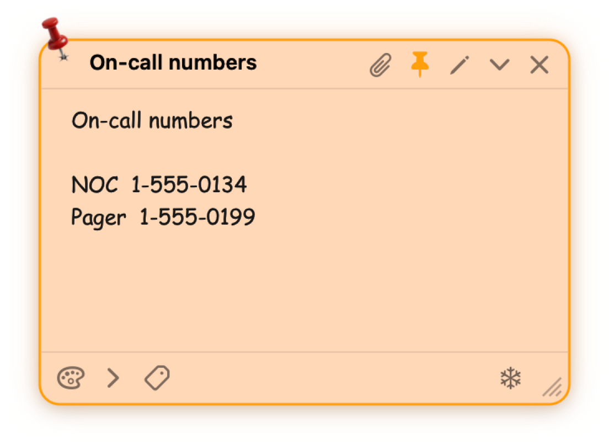
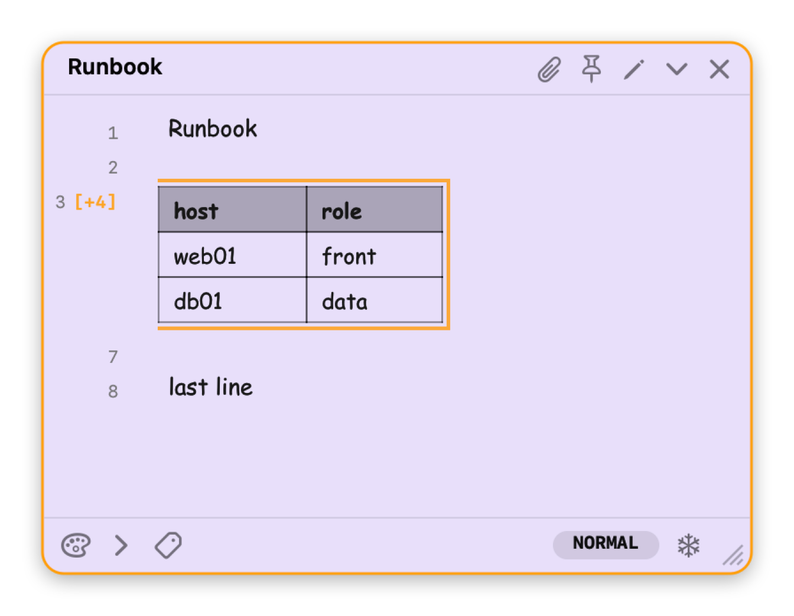
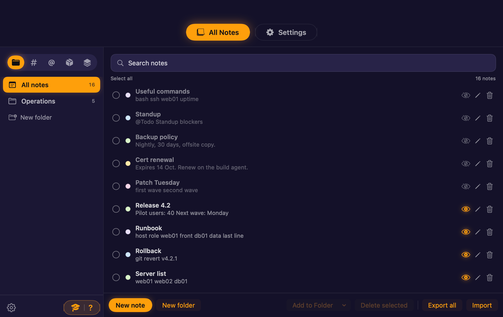

<div align="center">



# PinTack

**Sticky notes for macOS, with Obsidian's editing model and a plugin system.**

*Stick it. Stack it. Ship it.*

Plain Markdown files. Live Preview rendering. Todos with reminders. A plugin system.
Open source, GPL-3.0.

`Status: built and running; build 23 was the first for outside testers (0.1.0). Phases 1–4 complete.`
`Not yet signed or notarized — see Distribution.`
`Seeking a macOS developer to own the codebase.`




<sub>Every screenshot on this page is taken from the running app by <code>scripts/make-tutorial-shots.sh</code> — none is a mockup.</sub>


**[Installing](#installing) · [Features](#feature-list) · [Keyboard shortcuts](#keyboard-shortcuts) ·
[Slash commands](#slash-commands) · [Building](#building) · [Plugins](docs/PLUGINS.md) ·
[Spec](SPEC.md)**

</div>

---

## What it is for

PinTack is for **short notes on the fly**: condensed data, important data, or both. Developers get
special attention, for the snippets that move between tools and workflows: a command, a hostname, a
config block, a checklist for the deploy. It is **not** a knowledge base, a wiki or a place for
documentation. Obsidian and tools like it exist for those, and do them well.

## Why this exists

A commercial sticky-notes app on the Mac App Store does the basics well and sits around #58 in Productivity with a 4.2-star rating. It is also roughly 377 MB, which is what an Electron bundle costs you.

Its users have been asking the same things for years: a hotkey to start a note, a pin to float it on top, an opacity slider, a central window listing every note, folders, tags, widgets, and a way to get your data out. The requests go unanswered, and the architecture is most of the reason why. WidgetKit is effectively out of reach from Electron. Native window levels and non-activating panels are awkward through a browser abstraction.

PinTack is the native answer to that feature list. The app is **20 MB**; the disk image is 8.6 MB.

## What makes it different

### 📝 Live Preview markdown



Formatting renders as you type. Raw syntax appears only on the line holding your cursor. Same model Obsidian uses, applied to sticky notes. This is the primary quality bar for v1: if Live Preview feels janky, the product has failed regardless of what else ships.

### 🧩 An interactive widget — *designed, not yet built*

Tick a checkbox on a desktop widget without opening the app. Apple's own Notes widget is read-only, Windows Sticky Notes has nothing, and no competitor in this category ships one. It is shelved until a signing team is chosen, because an app group identifier must carry the Team ID (SPEC.md §11.2).

### 🗄️ Your notes are files

```
~/Documents/PinTack/
├── Work/
│   └── 2026-09-19-sprint-blockers.md
├── attachments/
│   └── 2026-09-19-142233.png
└── plugins/
    └── runner/
```

Real Markdown with YAML frontmatter, in a folder you can open in Finder. Which means:

- **Export is not a feature.** The files are the export. Zip the folder.
- **Sync is not a feature.** Put the vault in iCloud Drive, Dropbox, or Syncthing.
- **The data outlives the app.** If this project dies, you still open your notes in any text editor.

For a project whose origin story is "the incumbent stopped listening," shipping a format that traps users would be incoherent.

### 🔌 Plugins, with one in the box

JavaScript plugins with a documented API. v1 ships **Runner**: inline buttons in your notes that execute a script, open a URL, reveal a path in Finder, or fire a macOS Shortcut.

````markdown
```runner
label: Rebuild search index
run: ~/bin/reindex.py
```
````

Language agnostic. If the dependencies are on your machine, it runs. Every command requires explicit first-run approval, trust is bound to the exact command string, and editing a command resets its approval. No autorun exists, and no flag adds one.

Runner is built strictly against the public plugin API with no private hooks into the core. That is the only way a reference plugin proves anything.

## A look at it

| | |
|---|---|
|  | **Todos that track themselves.** Progress squares wrap six to a row, a finished todo ticks and strikes itself through and dims, and a due date with a reminder travels in the note's own frontmatter. |
|  | **Code blocks on their own panel**, with the language's logo and name. Every language CodeMirror ships is available; the parser for one is loaded only when a note actually contains it. |
|  | **Tags as coloured pills.** The colour comes from a hash of the tag's own text, so it is the same on every Mac and across relaunches. They wrap to fit and overflow into a `+N` you can click. |
|  | **Pin a note on top** and it glows in its own colour, with a real pushpin overhanging the corner. Per-note opacity, collapse to the title bar, and freeze to let clicks pass straight through. |
|  | **Vim mode**, off by default. `:` and `/` open in the note's action bar rather than over the page, and a rendered table is a fold in the gutter — `zo` to open it. |
|  | **One window for everything**: folders, tags, todos, templates and stacks as glyph tabs, full-text search across the vault, and Settings as the second tab of the same window. |

## Feature list

| | |
|---|---|
| ✍️ Editing | Live Preview markdown, Source mode toggle, slash commands, clickable task checkboxes (⌘↩ ticks the current line), tables, rich text pasted as Markdown |
| 💻 Code | Syntax highlighting for every language CodeMirror ships, loaded only when a note uses it; a language logo and name on each block; code blocks on their own dark panel |
| 🖼️ Images | Paste or drop; resize and crop right inside the note, with nothing to type; the original is never overwritten |
| 🪟 Windows | Floating non-activating note panels, pin-on-top with a real pushpin and a glow in the note's colour, per-note opacity, collapse, freeze, auto-arrange, cross-Space visibility, notes rescued from an unplugged display |
| 🎨 Appearance | Light/dark app theme independent of note colors, arbitrary note colors with automatic text contrast, outline color and width, glow strength, rounded or square corners |
| 🏷️ Tags | Coloured pills in each note, colour picked automatically from the name or chosen by you, wrapping to fit |
| ✅ Todos | Progress squares that wrap six to a row, a progress bar on a collapsed todo, a finished todo that ticks and strikes itself through, due dates and reminders, a todos tab that sorts by how done things are |
| 🗂️ Organization | One window for All Notes and Settings, with folders, tags, todos and templates, full-text search, show/hide per note |
| ⌨️ Keyboard | System-wide hotkeys with no Accessibility permission required, fully rebindable with a recorder UI |
| 🧩 Extension | JavaScript plugin API with a capability/permission/approval model, Runner bundled. WidgetKit widget designed but not built |
| ⌨️ Vim | Optional vim keys (off by default): NORMAL/INSERT/VISUAL shown in the action bar, `:` and `/` open in the action bar, `:w` `:q` `:wq` `ZZ`, a line-number gutter where a table is a fold (`[+3]`, `zo`/`zc`); line numbers in code blocks as their own setting |
| 🗃️ Stacks | Pile 2 to 10 notes into one with the paperclip: title bars fanned, a stack bar to rename, add or remove notes, pin (the whole pile glows), collapse, close or unstack, #1–#10 on ⌘1–⌘9 and ⌘0, ⌥Tab to cycle, and a Stacks tab in All Notes |
| 🧊 Extras | Templates recalled with `@name`, quick capture from any app, `/find` fuzzy open, link previews (off by default), Undo for five seconds after a delete, empty notes that clean up after themselves, a one-screen welcome on first launch, and a **Tutorial** of twelve slides whose screenshots are taken by the app itself |

## Installing

**Today:** download the disk image from [Releases](https://github.com/mgmourad/PinTack/releases),
drag PinTack to Applications, then **right-click it → Open** the first time. That step is needed
because the build is not yet notarized by Apple — the image carries a READ ME spelling out all three
ways past Gatekeeper.

**Homebrew** is written and ready (`packaging/homebrew/pintack.rb`) but not yet published, and the
reason is worth stating plainly: Homebrew quarantines everything it downloads, and as of Homebrew 7
there is no `--no-quarantine` escape hatch. An un-notarized app installed through `brew` would
install fine and then refuse to open. **Notarization is a prerequisite, not a nice-to-have.**

Once it is notarized, installing becomes:

```bash
brew tap mgmourad/pintack
brew install --cask pintack
```

**[docs/HOMEBREW.md](docs/HOMEBREW.md)** has the whole path — signing, notarizing, the release, the
tap, and what the official `homebrew/cask` repository requires (225 stars, or 90 forks/watchers, for
a self-submitted app).

Requires macOS 14 (Sonoma) or newer. Apple Silicon and Intel.

## Keyboard shortcuts

Every one of these is rebindable in Settings → Shortcuts, with a recorder that warns about conflicts.
**Global** shortcuts fire from any application and need no Accessibility permission; the rest act on
the focused note, so they only fire while PinTack has a window. The defaults:

<!-- shortcuts:start -->
#### Notes

| Shortcut | Action | Scope |
|---|---|---|
| `⌥⌘N` | New note | Global |
| `⌥⌘L` | New todo note | Global |
| `⌥⌘C` | New note from the clipboard | Global |
| `⌥⌘D` | Delete focused note | In PinTack |
| `⌥⌘P` | Pin / unpin focused note | In PinTack |
| `⌥⌘K` | Collapse / expand focused note | In PinTack |
| `⌥⌘F` | Freeze / thaw focused note | In PinTack |
| `⌥⌘W` | Close focused note | In PinTack |
| `⌥⌘M` | Toggle Live Preview / Source | In PinTack |

#### Appearance

| Shortcut | Action | Scope |
|---|---|---|
| `⌥⌘E` | Emoji picker | In PinTack |
| `⌥⌘1` | Note color 1 (Butter) | In PinTack |
| `⌥⌘2` | Note color 2 (Peach) | In PinTack |
| `⌥⌘3` | Note color 3 (Mint) | In PinTack |
| `⌥⌘4` | Note color 4 (Sky) | In PinTack |
| `⌥⌘5` | Note color 5 (Lilac) | In PinTack |
| `⌥⌘6` | Note color 6 (Graphite) | In PinTack |
| `⌥⌘R` | Round / square corners | In PinTack |
| `⌥⌘,` | Less opaque | In PinTack |
| `⌥⌘.` | More opaque | In PinTack |

#### Stacks

| Shortcut | Action | Scope |
|---|---|---|
| `⌥Tab` | Next note in the stack | In PinTack |
| `⌘1` | Stack note #1 to the front | In PinTack |
| `⌘2` | Stack note #2 to the front | In PinTack |
| `⌘3` | Stack note #3 to the front | In PinTack |
| `⌘4` | Stack note #4 to the front | In PinTack |
| `⌘5` | Stack note #5 to the front | In PinTack |
| `⌘6` | Stack note #6 to the front | In PinTack |
| `⌘7` | Stack note #7 to the front | In PinTack |
| `⌘8` | Stack note #8 to the front | In PinTack |
| `⌘9` | Stack note #9 to the front | In PinTack |
| `⌘0` | Stack note #10 to the front | In PinTack |

#### Windows

| Shortcut | Action | Scope |
|---|---|---|
| `⌥⌘H` | Show / hide All Notes | Global |
| `⌥⌘A` | Auto-arrange notes | Global |
| `⌥⌘T` | All Notes, by tag | Global |
| `⌥⇧2` | All Notes, templates | Global |
| `⌥⇧T` | All Notes, todos | Global |
| `⌥⇧=` | Show / hide opened notes | Global |
| `⌥⌘/` | Show shortcut list | In PinTack |

#### Data

| Shortcut | Action | Scope |
|---|---|---|
| `⌥⌘X` | Export all notes | In PinTack |
| `⌥⌘I` | Import archive | In PinTack |

<!-- shortcuts:end -->

Inside a note, <kbd>⌘↩</kbd> ticks the checkbox on the current line and <kbd>Tab</kbd> steps out of a
coloured span. <kbd>⌥⌘/</kbd> shows this list in the app.

## Slash commands

Type <kbd>/</kbd> in any note. A bare `/` lists everything; typing filters.

<!-- slash:start -->
#### Text and formatting

| Command | What it does |
|---|---|
| `/h1` | Heading 1 |
| `/h2` | Heading 2 |
| `/h3` | Heading 3 |
| `/bold` | Bold |
| `/italic` | Italic |
| `/strike` | Strikethrough |
| `/quote` | Blockquote |
| `/list` | Bulleted list |
| `/numbered` | Numbered list |
| `/checklist` | Checklist |
| `/divider` | Divider |
| `/highlight` | Highlight |
| `/link` | Link |
| `/table` | Table |
| `/code` | Code block |
| `/date` | Today's date |
| `/time` | Current time |
| `/tag` | Tag |

#### The note, and the app

| Command | What it does |
|---|---|
| `/freeze` | Freeze / thaw (click-through) |
| `/find` | Find a note… |
| `/stack` | Create a stack from this note… |
| `/addToStack` | Add this note to a stack… |
| `/removeFromStack` | Take this note out of its stack |
| `/settings` | Open Settings |
| `/allnotes` | Open All Notes |
| `/destroy` | Delete this note |
| `/template` | Save as template… |
| `/image` | Image from Finder… |
| `/emoji` | Emoji picker |

#### Colours and code blocks

| Command | What it does |
|---|---|
| `/red`, `/orange`, `/green`, `/blue`, `/purple`, `/pink`, `/gray` | Coloured text. The `<span>` tags stay hidden in the editor; <kbd>Tab</kbd> leaves the span. |
| `/code-powershell`, `/code-bash`, `/code-python`, `/code-json`, `/code-yaml`, `/code-sql`, … | A fenced code block in that language — 17 of them, each with its logo on the panel. |

<!-- slash:end -->

Type <kbd>@</kbd> for templates — a bare `@` lists every template you have, and `@name` inserts that
template's body. `@todo` converts the note you are in into a todo.

## Architecture in one paragraph

A Swift/AppKit shell hosts one `NSPanel` per note. Each panel embeds a `WKWebView` running CodeMirror 6, which provides Live Preview and doubles as the plugin execution context. A `VaultStore` owns all file I/O against the Markdown vault, with an FSEvents watcher and an SQLite FTS5 search index that is fully disposable. All Notes and Settings share one SwiftUI window. The widget, when it is built, will read a denormalized snapshot through an App Group container.

**`WKWebView` is not Electron.** It uses the WebKit already installed in macOS. Nothing is bundled, which is the entire difference between 20 MB and 377 MB.

Full detail in **[SPEC.md](SPEC.md)**, which is written for a developer picking this up cold.

## Status and roadmap

| Phase | Scope | Status |
|---|---|---|
| 1 | Shell, vault, note panels | **Done** |
| 2 | CodeMirror editor, Live Preview | **Done** |
| 3 | Central window, search, settings, hotkeys | **Done** |
| 4 | Plugin API, Runner | **Done** |
| 4 | WidgetKit widget | Shelved — needs a signing team |
| 5 | Signing, notarization, Sparkle, DMG, Homebrew | Styled DMG **done**; the rest waits on a signing team |

Verified three ways by one command: a Release build (what actually ships), **241 unit tests**, and a
self-test that launches the app, drives its own windows and web views with real events, asserts
**nearly 300** things about what happened, photographs every window as evidence, and exits non-zero if
any of them is wrong. A check it cannot fairly judge — another app in front, no window holding the
keyboard, a person typing while it runs — says *skipped* rather than failing:

```bash
scripts/verify.sh
```

## Building

```bash
git clone https://github.com/mgmourad/PinTack.git
cd PinTack
xcodebuild -scheme PinTack -configuration Debug SYMROOT="$PWD/build" build
open build/Debug/PinTack.app
```

Verify a change with `scripts/verify.sh` (a Release build, the unit tests **and** the self-test; all
must pass). Build a distributable disk image with `scripts/make-dmg.sh`.

Requires Xcode 16+ and macOS 14+. A free Apple ID is sufficient for local development; the paid Developer Program membership is only needed to produce notarized releases. `CLAUDE.md` holds the working notes: the platform traps, the decisions and their reasons.

## 🙋 Wanted: a maintainer

Honest framing, because vague calls for help waste everyone's time.

**What exists:** a working app in beta — vault, note windows, Live Preview editor, todos and reminders, All Notes and Settings, hotkeys, plugins and Runner — with a specification kept in step with it, a changelog of every change and why ([CHANGELOG.md](CHANGELOG.md)), a test suite, and a self-test that can fail a build.

**What does not exist:** the widget, code signing, notarization, Sparkle updates, and the App Sandbox. Those are Phase 5 and the open decisions in SPEC.md §17.

**Who owns what:** the project originator handles product direction, positioning, assets, and funding. He is a Windows endpoint automation engineer, not a Swift developer, and is explicit that he will not be maintaining the codebase. A technical maintainer takes ownership of the code and a real stake in the project's direction.

**Why this is worth your time:** the hard thinking is done. Most open source projects hand you an idea and a shrug. This one hands you a spec that already answers the structural questions, including the ones that bite in month two: the transparent-margin window architecture, the Team-ID-prefixed App Group requirement that silently kills widgets, the shell PATH problem for GUI-launched processes.

**What this is not:** a paid contract, a startup, or a company. It is an open source project looking for someone who wants to own a well-specified Mac app.

Open an issue or start a discussion if you are interested.

## Distribution

Not the Mac App Store, and this was settled twice over: a sandboxed app cannot spawn user processes, which rules out Runner, and GPL-3.0 is independently incompatible with App Store terms.

Releases will ship as a notarized DMG, a Homebrew cask, and GitHub Releases, with Sparkle for auto-updates. The cask and the steps to publish it are in [docs/HOMEBREW.md](docs/HOMEBREW.md).

**Today the DMG is ad-hoc signed and *not* notarized**, so Gatekeeper blocks the first launch on another Mac. The disk image carries a note explaining the three ways past it (right-click → Open; Privacy & Security → Open Anyway; `xattr -dr com.apple.quarantine`). Until a signing team is chosen this is a build for testers, not a release.

## License

**GPL-3.0-or-later.** Full text in [LICENSE](LICENSE).

You can do anything you like with this code, including sell it. What you cannot do is close it. Any
distributed derivative must ship complete source under the same license, so improvements come back to
everyone.

**Plugins are different.** A plugin that communicates solely through the documented public API is not
a derivative work of PinTack, and its author may license it however they choose.

PinTack is built on third-party components under permissive licences, listed with their full licence
texts in [ACKNOWLEDGEMENTS.md](ACKNOWLEDGEMENTS.md), which also ships inside the app.

## Contributing

See [CONTRIBUTING.md](CONTRIBUTING.md). Plugin authors start at [docs/PLUGINS.md](docs/PLUGINS.md)
and [SPEC.md §12](SPEC.md#12-plugin-api). What changed, when, and why: [CHANGELOG.md](CHANGELOG.md).

The shortcut and slash-command tables above are generated from the source that defines them —
`python3 scripts/make-reference-tables.py` after adding either, so the README cannot quietly list a
key the app no longer has. The screenshots come from `scripts/make-tutorial-shots.sh`, which drives
the real app against a throwaway vault.
